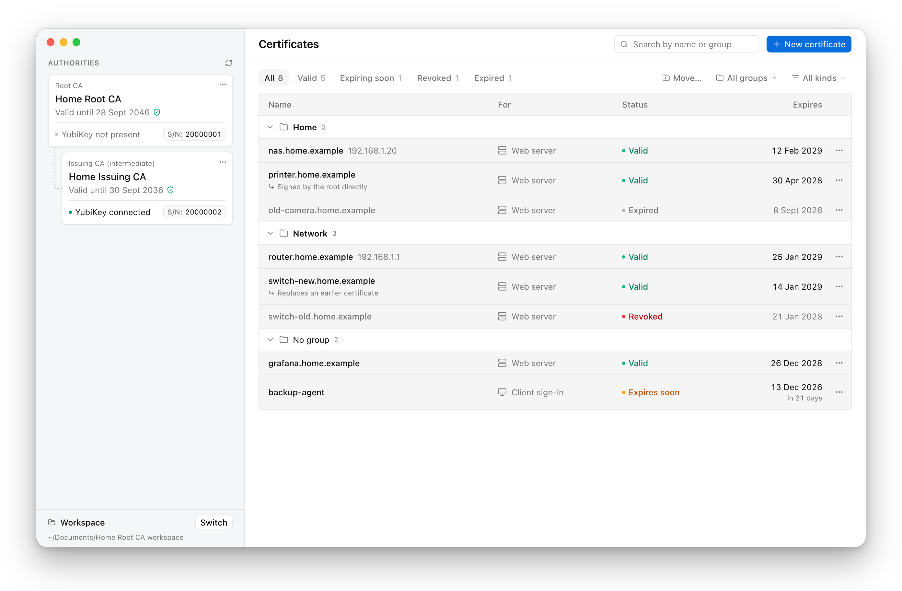
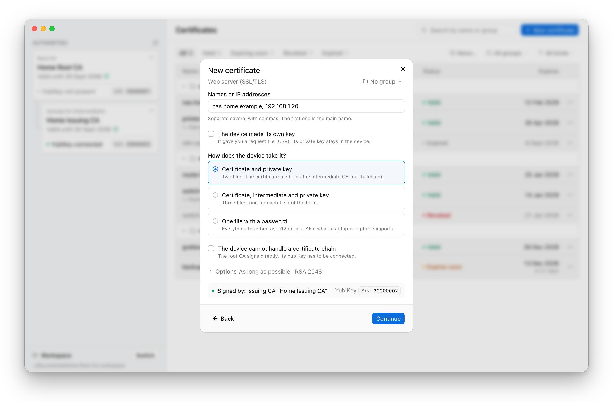
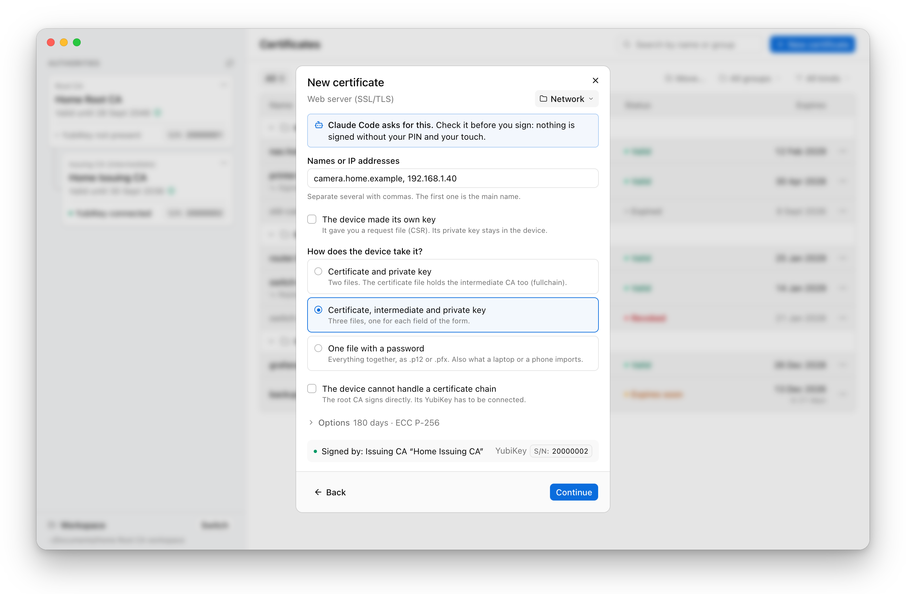
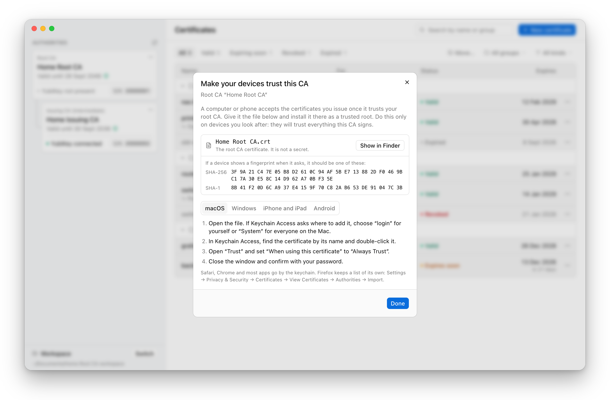

# CA for YubiKey

A small macOS app for running your own certificate authority: TLS certificates for the web interfaces of your devices, IPsec certificates for your VPN. The private keys of the CA are made inside YubiKeys and never leave them.

It is meant for a home lab or a small office, where a public CA is of no use and a full PKI product is too much. If you have used [XCA](https://hohnstaedt.de/xca/) for this, CA for YubiKey does the same job with fewer choices to make and with the CA keys on hardware instead of in a file.

<picture>
  <source media="(prefers-color-scheme: dark)" srcset="docs/screenshots/main-dark.png">
  
</picture>

## What it does

- **Creates the CA on YubiKeys.** A root CA on one YubiKey, which you keep in a safe, and an issuing CA on a second one for everyday use. One YubiKey alone works too, with the root CA signing everything.
- **Takes over a CA you already have** on YubiKeys from another tool. Nothing is written to the keys.
- **Issues certificates by what they are for:** a web server, a VPN gateway, a VPN client, a TLS client.
- **Hands them over as the files the device's upload form asks for,** and nothing else to pick from: `fullchain.crt` and `private-key.key` for a form with a field for the certificate and one for the key; `certificate.crt`, `intermediate-ca.crt` and `private-key.key` for one with a field each; one password-protected `certificate.p12` for a form with a single file, and for laptops and phones. If the form turns out to ask for something else, the files are written again in the other form without issuing anything.
- **Signs a device's own request (CSR)** when the device keeps its private key.
- **Renews, changes names, revokes.** A renewed certificate keeps the device's key, so only the certificate has to be installed again. Its folder has the key too, in the same form of files as before, so it is complete on its own.
- **Signs revocation lists (CRL)** and tells you when one is due.
- **Keeps many certificates in order.** Sort them into groups of your own, by customer or site, filter by group, kind and status, sort by any column, and move several at once.
- **Works with AI agents.** An agent can look at a workspace, sort it and revoke by itself, through `yca mcp`. Whatever needs a signature it hands to the app's window, where you check it, type the PIN and touch the key. No agent is ever given a PIN.
- **Shows how to make your devices trust the CA.** The root CA certificate is in the workspace as a file a Mac, a Windows PC, an iPhone or an Android phone can open, and the app has the steps for each of them, with the fingerprints to compare.
- **Replaces a lost issuing CA.** The root CA signs a new one on another YubiKey; your devices go on trusting the root. If the old YubiKey was stolen, the root CA revokes the old issuing CA as well.

Every signature needs the PIN of the YubiKey and a touch.

## What it looks like

A new certificate is asked for by what it is for and by what the device's upload form takes:

<picture>
  <source media="(prefers-color-scheme: dark)" srcset="docs/screenshots/new-certificate-dark.png">
  
</picture>

An AI agent asks for a certificate, and the window shows what it asked for and who asks. Nothing is signed until you type the PIN and touch the key:

<picture>
  <source media="(prefers-color-scheme: dark)" srcset="docs/screenshots/agent-dark.png">
  
</picture>

Devices trust your certificates once they trust the root CA; the app has the steps for each system, with the fingerprints to compare:

<picture>
  <source media="(prefers-color-scheme: dark)" srcset="docs/screenshots/trust-dark.png">
  
</picture>

The pictures show the sample data of the app's preview, not a real authority.

## What it does to a YubiKey

Only what a CA needs:

- It writes to PIV slot 9c (the key and the certificate of the CA).
- On a YubiKey that still has its factory PIN, it sets the PIN, PUK and management key you choose.
- On request it changes a PIN, or sets a new one with the PUK.
- It never touches the other PIV slots or FIDO2, OpenPGP and OATH. An SSH key or passkey on the same YubiKey stays where it is.

The one exception is the reset (Reset YubiKey… in the window, `yca reset` on the command line), for a YubiKey whose PIN and PUK are both lost: it wipes the whole PIV application, every slot of it, after listing what is there and asking for the serial number. Even that leaves FIDO2, OpenPGP and OATH alone.

Putting a new CA on a YubiKey destroys what slot 9c held. The app says so and asks you to type the serial number of the key first.

## The workspace folder

One CA, one folder: its workspace. Everything the app keeps for that CA is in there and nowhere else, as plain files:

- the CA certificates and the current revocation lists,
- the root CA certificate once more as a `.crt` file named after the CA, to install on the devices that are to trust it,
- a folder for every certificate you issued, named after it (`nas.example.com`), with the files to install on the device; certificates you sorted into a group are inside a folder named after the group,
- the list of those certificates, and the app's own copy of each, so that the files in a certificate's folder are yours to take.

The keys of the CA are never in it. The private keys of the certificates you issue are, each in the folder of its certificate, unless the device made its own key. So keep the workspace where only you can read it, and back it up with the same care. If the folder is lost, the CA still works and can be given a new one; what is lost is the list, and with it the means to revoke.

## Requirements

- A Mac with Apple silicon and macOS 13.3 or newer. The released app does not run on a Mac with Intel; built from source it may, but that has not been tried.
- One or two YubiKeys of the 5 series. The blue Security Key has no PIV and will not work.

## Installing

Download the disk image from the [latest release](https://github.com/yca-app/yca/releases/latest), open it and drag the app to Applications. The app is signed and notarised by Apple. Each release lists the SHA-256 of its disk image, to compare with what you downloaded.

## Updates

The app looks for a newer release when it starts, at most once a day, and says so in its window when there is one. Nothing is downloaded until you say so. Update… shows what changed, and Install and restart downloads the new version, checks it against a key built into the app, puts it in place of the old one and starts it. Check for Updates… in the app's menu looks at once. The same dialog has the switch that stops the app from looking by itself.

Looking is one request to GitHub, where the releases are, for the description of the latest one. Nothing about you, your workspace or your YubiKeys is sent. An app you built yourself does not look, and cannot update itself.

## Building from source

To build the app yourself you need Rust 1.90 or newer and a current Node.js.

```sh
npm --prefix app install
npm --prefix app run tauri build
```

The app is left in `target/release/bundle`, unsigned. `scripts/release.sh --unsigned` builds it as a release has it, with the `yca` command, the licence and the notices of the software it is built from inside. To work on the app, `npm --prefix app run tauri dev` starts it and reloads on changes.

## Command line

The same core is available as a command, `yca`, which is also how the core is tried out during development. A released app carries it inside, at `/Applications/CA for YubiKey.app/Contents/MacOS/yca`. From source:

```sh
cargo build --release -p yca-cli     # leaves target/release/yca

yca devices                                           # what is connected; reads only
yca init-root --name "Home Root CA" --device 11111111
yca init-issuing --name "Home Issuing CA" --device 22222222
yca adopt --store ~/Documents/home-ca                 # start a workspace from the YubiKeys
yca issue --store ~/Documents/home-ca --profile tls-server \
    --name nas.example.com --name 192.168.1.20        # files go to home-ca/certificates/nas.example.com
yca list --store ~/Documents/home-ca
yca group --store ~/Documents/home-ca --serial 5d20be --name "Office"   # sort it into a group
yca repackage --store ~/Documents/home-ca --serial 5d20be --files separate   # the same certificate, as other files
```

`--files` says what the device's upload form asks for: `fullchain` (the default), `separate` or `p12`. It goes with `issue`, `sign-csr` and `repackage`.

`yca help` lists the rest: `reissue`, `revoke`, `revoke-ca`, `delete`, `crl`, `sign-csr`, `trust`, `attest`, `protect`, `pin`, `unblock`, `reset` and `demo`, which makes a throwaway CA in memory so you can look at the files without a YubiKey.

With `--json`, every command answers with one JSON document on standard output, for scripts: `yca --json list --store ~/Documents/home-ca`. The window and the command line can work on the same workspace at the same time; what one does shows up in the other within a second.

## AI agents

`yca mcp` serves a workspace to an AI agent over the [Model Context Protocol](https://modelcontextprotocol.io). For a program that reads its servers from a JSON file:

```json
{
  "mcpServers": {
    "yca": {
      "command": "/Applications/CA for YubiKey.app/Contents/MacOS/yca",
      "args": ["mcp"]
    }
  }
}
```

For Claude Code: `claude mcp add yca -- "/Applications/CA for YubiKey.app/Contents/MacOS/yca" mcp`.

That is the command inside the app. If you built `yca` yourself, name the place you put it.

The agent can then look at your YubiKeys and workspaces, sort certificates into groups, write their files again in the form another upload form asks for, and mark them as revoked. For anything that needs a signature (a new certificate, a renewal, a revocation list) it asks the app instead: the window opens the usual dialog, filled in with what the agent asked for and saying who asks. You check it, type the PIN and touch the key, and the agent is told how it went. Deleting a certificate is put to you the same way, and creating a CA opens the wizard for you to go through.

You are not interrupted: a request that comes while you are in the middle of something in the window waits until you are done, and one whose agent has gone away in the meantime is dropped.

There is no way to give an agent a PIN, a PUK or a password through `yca`, and none to reset a YubiKey. If an agent asks you for a PIN, do not tell it.

## What to keep in mind

- **Revocation only works where a device checks it.** A VPN gateway refuses a revoked client certificate once you have given it the new revocation list. Browsers mostly do not check the lists of a private CA.
- **The libraries have not been audited,** in particular the one that talks to the YubiKey, which is used in a pre-release version because of firmware 5.7 and later.
- **The workspace holds private keys of the certificates you issue.** Whoever reads it can pose as those devices until you revoke them. They cannot issue anything: the keys of the CA are only on the YubiKeys.
- **An agent can ask, but not sign.** A program that reaches `yca mcp` or the app's socket can make the window show a signing dialog. Nothing is signed unless you type the PIN and touch the key, so read what the dialog says before you do.
- **The app trusts its workspace folder.** It checks that the CA certificates in it belong together and match the connected YubiKeys, but the list of issued and revoked certificates is not signed.
- **An update is as good as the project's repository.** Releases are built on GitHub, where the key that updates are signed with is kept as well. The app installs nothing that is not signed with that key, and nothing unasked, but whoever controls the repository can release an update.
- A YubiKey's statement that a key was made inside it is kept, but not yet checked against Yubico's own root certificate.

## Development

```sh
cargo fmt --all --check
cargo clippy --workspace --all-targets -- -D warnings
cargo test --workspace
npm --prefix app run build
```

None of the tests needs a YubiKey. Without the Rust side, `npm --prefix app run dev` serves the window in a browser with sample data, which is how the interface is worked on. While it runs, `node scripts/screenshots.mjs` takes the pictures in `docs/screenshots` again from that sample data, with Google Chrome.

The repository has three parts: `crates/yca-core` (everything that decides anything), `crates/yca-cli` (the `yca` command) and `app` (the window, built with Tauri and React). What the code holds to is in [CONTRIBUTING.md](CONTRIBUTING.md). What changed between versions is in [CHANGELOG.md](CHANGELOG.md), how a release is made in [RELEASING.md](RELEASING.md), and how to report a security problem in [SECURITY.md](SECURITY.md).

## Licence

CA for YubiKey is free software under the [GNU General Public License](LICENSE), version 3 or, at your option, any later version. It comes with no warranty.

Contributions are welcome under the terms in [CONTRIBUTING.md](CONTRIBUTING.md).

This project is not affiliated with or endorsed by Yubico. YubiKey is a trademark of Yubico AB.
